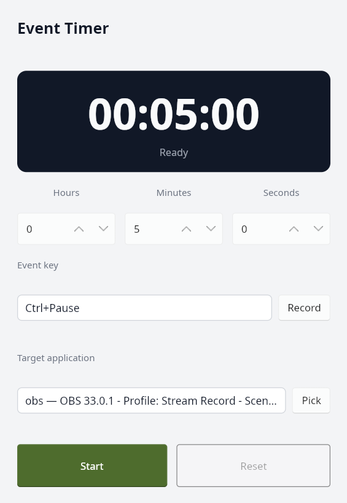

# Event Timer

A small countdown timer with a native UI, written in C++20 with
[Slint](https://slint.dev) and built with meson.



## Features

- Set a duration with hours / minutes / seconds steppers (0-23, 0-59, 0-59).
- Record an event key combination with the `Record` button: the next key press is
  stored and shown as e.g. `Ctrl+Shift+A`, `Alt+F1` or `Space`.
- Pick a target application with the `Pick` button: the next window you click
  becomes the destination for the event. The target is saved to the user
  configuration and restored on startup.
- The recorded event is saved to the user configuration and restored on startup.
- Start, pause, resume and reset the countdown.
- Remaining time is displayed as `HH:MM:SS` and updated every second.
- When the countdown reaches zero, the recorded event is sent with `xdotool` and a
  modal dialog confirms what happened.

Event sending is currently X11-only and requires `xdotool` in `PATH`. Without a
target, the event goes to the focused window; if Event Timer itself is focused,
sending is skipped so the injected key does not hit the timer's own modal. With a
target, the event is sent directly to that window, even when Event Timer has focus.

Sending directly to a target window is useful for applications such as OBS, whose
global hotkeys use XInput2 raw key events that `xdotool` XTEST events do not
trigger while the application is unfocused. Native Wayland sessions are not
supported.

## Configuration

The recorded event and the optional target application are stored in:

```
$XDG_CONFIG_HOME/event-timer/config.json
```

or `~/.config/event-timer/config.json` when `XDG_CONFIG_HOME` is unset. The target
is stored by window class and title, so it is rediscovered when the application
restarts.

## Prerequisites

- A C++20 compiler (g++ 13 or newer, or clang 16 or newer)
- meson >= 1.1 and ninja
- ruby (standard library only) for the Slint download script
- `xdotool` for sending the recorded event (X11 only)
- X11 development headers (`libx11-dev` or equivalent) for the window picker
- `myFunc/doctest.h` for the unit tests (optional, tests are skipped when absent)

`nlohmann/json` is pulled in automatically as a meson subproject
(`subprojects/nlohmann_json.wrap`).

## Slint

The Slint C++ library is not packaged on most distributions, so the project uses
the official prebuilt binary release, pinned to `1.18.1`:

```sh
ruby scripts/fetch_slint.rb           # download + verify + unpack
ruby scripts/fetch_slint.rb --force   # re-download
```

The script verifies the tarball against its SHA-256 and unpacks it into
`subprojects/slint-cpp` (`bin/slint-compiler`, `include/slint`, `lib/libslint_cpp.so`).
`meson setup` runs the script automatically when that directory is missing.

The package can also be provided elsewhere with `-Dslint_dir=/path/to/slint-cpp`.

## Build

```sh
meson setup build
meson compile -C build
```

The `.slint` file is compiled to `app.h` / `app.cpp` at build time by
`slint-compiler`, so no `.slint` file is read at run time. The executable carries
an rpath to the Slint library directory, so `LD_LIBRARY_PATH` is not needed.

## Run

```sh
./build/event-timer
```

## Test

```sh
meson test -C build
```

Unit tests cover the countdown logic (formatting, ticking, pause/resume, reset and
expiry), the event model (key conversion, display, xdotool sequences, JSON round
trip) and config persistence (event, target window and both together). The doctest
header is looked up in `-Dmyfunc_dir` (empty by default, which disables the unit
tests); set `-Dtests=false` to skip the test targets entirely.

## Layout

```
ui/app.slint                Slint UI description
src/main.cc                 wiring between the UI, timer, config, picker and sender
src/countdown_timer.hh/.cc  countdown state machine (steady_clock based)
src/event_key.hh/.cc        recorded event model, display and xdotool mapping
src/target_window.hh/.cc    target application model and JSON serialization
src/config.hh/.cc           XDG JSON configuration load/save
src/key_sender.hh/.cc       xdotool event injection (focused or target window)
src/x11_window.hh/.cc       X11 window lookup and metadata helpers
src/window_picker.hh/.cc    interactive target window picker
src/countdown_timer_test.cc doctest unit tests
src/event_key_test.cc       doctest unit tests
src/target_window_test.cc   doctest unit tests
src/config_test.cc          doctest unit tests
scripts/fetch_slint.rb      Slint C++ binary package downloader
```
